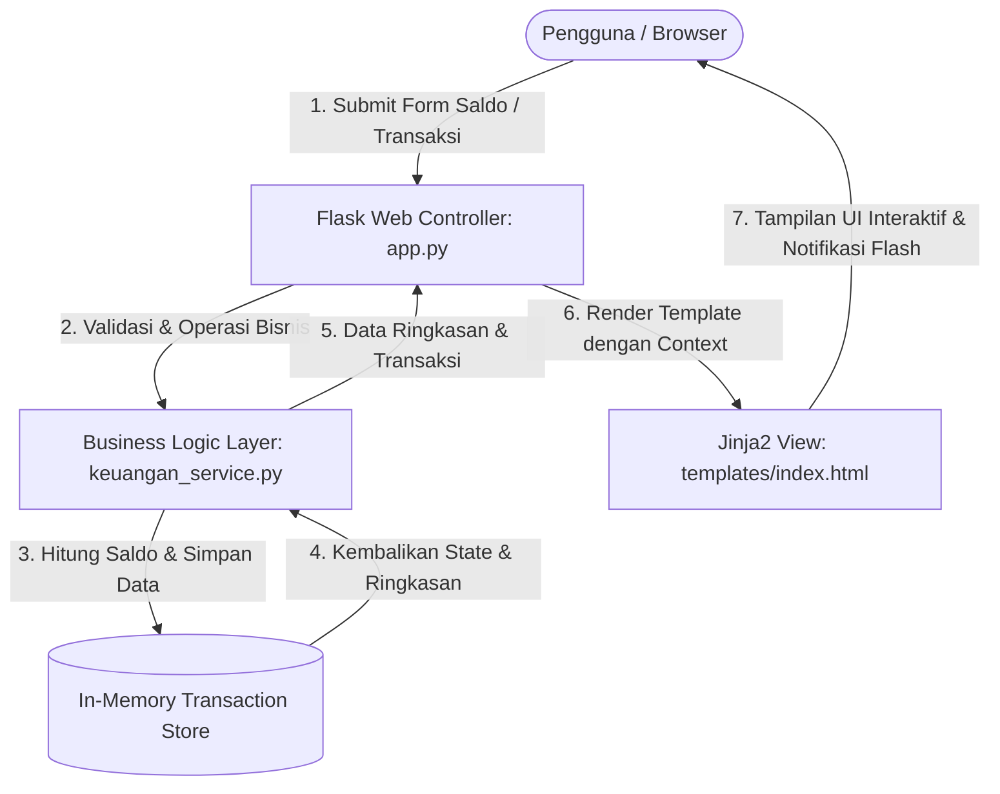

# 💰 Sistem Informasi Pencatat Keuangan Harian Berbasis Web

Aplikasi web sederhana dan andal untuk mencatat arus kas harian pribadi, mengelola saldo awal, memantau pemasukan dan pengeluaran, serta menghitung sisa saldo akhir secara otomatis dan *real-time*.

---

## 📌 1. Identitas MVP (Minimum Viable Product)
- **Nama Produk:** Sistem Informasi Pencatat Keuangan Harian
- **Kategori:** Aplikasi Web Manajemen Finansial Pribadi
- **Tujuan Utama:** Membantu pengguna memonitor arus kas harian tanpa perhitungan manual yang rentan kesalahan (*human error*).
- **Teknologi:** Python 3 (Flask), HTML5, CSS3, JavaScript, Python Unittest.

---

## 🏗️ 2. Pertemuan 4: Scaffold, Identifikasi Masalah & Aliran Data

### A. Identifikasi Masalah Awal (Debugging & Konfigurasi)
Pada saat kode awal dijalankan dengan perintah `python app.py`:
1. **Penyebab:** Terjadi error `jinja2.exceptions.TemplateNotFound: index.html` (HTTP 500). Hal ini disebabkan file `index.html` diletakkan di direktori *root*, sedangkan konvensi default Flask mencari file *template* di dalam subfolder `templates/`.
2. **Solusi & Perbaikan:** 
   - Membuat direktori `templates/` dan memindahkan `index.html` ke dalam `templates/index.html`.
   - Memperbaiki binding data Jinja agar ringkasan keuangan dan riwayat transaksi tampil secara dinamis.
   - Menguji coba endpoint dengan test client: Hasil pengujian mengembalikan kode status **200 OK** dan UI berhasil dimuat di browser.

### B. Arsitektur Komponen dan Aliran Data (Data Flow Diagram)



### C. Penjelasan Komponen & Data yang Mengalir
1. **Lapisan Presentasi (`templates/index.html`):** Menyediakan antarmuka interaktif bagi pengguna untuk menginput saldo awal, menambahkan transaksi (pemasukan/pengeluaran), melihat kartu ringkasan, dan menghapus transaksi.
2. **Lapisan Pengendali (`app.py`):** Menerima request HTTP (GET dan POST), menangani routing, menangkap input form, serta meneruskan pesan feedback (*flash messages*) ke antarmuka.
3. **Lapisan Logika Bisnis (`keuangan_service.py`):** Mengisolasi seluruh aturan bisnis independen dari framework web. Menjalankan validasi angka non-negatif, klasifikasi transaksi, kalkulasi formula saldo, serta operasi penghapusan data.

---

## 🚀 3. Pertemuan 5: Pembangunan MVP Iteratif (2 Fitur Inti)

Pembangunan MVP Version 1 dilakukan secara terstruktur menggunakan siklus **Brief → Plan → Build → Verify → Commit** untuk 2 fitur inti:

### Fitur 1: Pengaturan Saldo Awal
- **Brief:** Pengguna harus dapat menentukan nominal modal/saldo awal sebagai basis perhitungan kas harian.
- **Plan:** Buat fungsi `set_saldo_awal(nominal)` yang memastikan nilai berupa angka valid dan $\ge 0$.
- **Build:** Implementasikan fungsi pada `keuangan_service.py` dan hubungkan form di `templates/index.html` dengan endpoint `/set-saldo`.
- **Verify:** Buat unit test pada `tests/test_saldo.py` untuk menguji nilai positif, nol, nilai desimal, serta penolakan nilai negatif dan non-numerik.
- **Commit:** `feat: implementasi pengaturan saldo awal dan validasi non-negatif`

### Fitur 2: Pencatatan Transaksi Pemasukan & Pengeluaran
- **Brief:** Pengguna dapat mencatat transaksi harian dengan rincian tanggal, jenis (pemasukan/pengeluaran), keterangan, dan nominal.
- **Plan:** Rancang struktur data transaksi dengan *unique ID*, validasi kelengkapan form, serta kalkulasi otomatis pemasukan dan pengeluaran.
- **Build:** Implementasikan `tambah_transaksi()` pada `keuangan_service.py` dan endpoint `/tambah` pada `app.py`.
- **Verify:** Buat unit test pada `tests/test_transaksi_pemasukan.py` dan `tests/test_transaksi_pengeluaran.py`.
- **Commit:** `feat: implementasi pencatatan transaksi pemasukan dan pengeluaran`

### Penjelasan Mahasiswa:
1. **Apa yang dikerjakan AI Agent:** Membantu membuat scaffold struktur proyek Flask, menyusun logika service `keuangan_service.py`, merancang layout antarmuka `templates/index.html`, serta menyusun suite unit test.
2. **Apa yang direview dan diubah oleh mahasiswa:** Memeriksa kesesuaian validasi aturan bisnis (seperti penolakan saldo negatif dan nominal nol), menyempurnakan pesan feedback flash pada antarmuka, serta memastikan semua test cases mencakup skenario ekstrim (*edge cases*).
3. **Bagaimana fitur diverifikasi:** Menjalankan unit test otomatis (`python -m unittest`) serta melakukan uji coba manual langsung di browser (*black-box testing*).
4. **Mengapa perubahan diperlukan:** Pemisahan file service dari file `app.py` sangat krusial agar kode memenuhi kaidah *Separation of Concerns*, sehingga pengujian unit test dapat berjalan cepat dan independen tanpa bergantung pada server web yang menyala.

---

## 🎯 4. Pertemuan 6: Penyempurnaan MVP & 5 User Stories

### A. Implementasi 5 User Stories dan Acceptance Criteria

| ID | User Story | Acceptance Criteria (Kriteria Keberterimaan) |
|---|---|---|
| **US-01** | **Manajemen Saldo Awal:** Sebagai pengguna, saya ingin mengatur dan memperbarui saldo awal saya agar perhitungan keuangan akurat. | 1. Input menerima angka $\ge 0$.<br>2. Nilai negatif menghasilkan pesan error validasi.<br>3. Input bukan angka ditolak sistem.<br>4. Saldo awal langsung diperbarui di kartu ringkasan. |
| **US-02** | **Pencatatan Pemasukan:** Sebagai pengguna, saya ingin mencatat pemasukan uang dengan nominal, tanggal, dan keterangan. | 1. Nominal pemasukan harus $> 0$.<br>2. Tanggal dan keterangan wajib diisi.<br>3. Menambah total akumulasi pemasukan secara instan.<br>4. Ditandai dengan badge hijau di riwayat. |
| **US-03** | **Pencatatan Pengeluaran & Ringkasan:** Sebagai pengguna, saya ingin mencatat pengeluaran uang dan melihat ringkasan saldo terkini secara otomatis. | 1. Nominal pengeluaran harus $> 0$.<br>2. Sistem menghitung secara otomatis:<br>$$\text{Saldo Akhir} = \text{Saldo Awal} + \text{Total Masuk} - \text{Total Keluar}$$<br>3. Jika saldo akhir $< 0$, sistem menampilkan indikator **Defisit Saldo!**. |
| **US-04** | **Riwayat & Penghapusan Transaksi:** Sebagai pengguna, saya ingin melihat riwayat seluruh transaksi dan dapat menghapusnya jika terjadi kesalahan input. | 1. Riwayat menampilkan nomor, tanggal, jenis, keterangan, nominal, dan tombol hapus.<br>2. Menghapus transaksi meminta konfirmasi.<br>3. Menghapus transaksi otomatis mengkalkulasi ulang sisa saldo. |
| **US-05** | **Validasi & Notifikasi Feedback:** Sebagai pengguna, saya ingin mendapatkan notifikasi pesan (alert) atas setiap aksi berhasil maupun input gagal. | 1. Sukses simpan/hapus menampilkan flash alert hijau (*success*).<br>2. Kesalahan input menampilkan flash alert merah (*danger*) dengan deskripsi jelas.<br>3. Status respon HTTP konsisten (redirect 302 / render 200). |

---

### B. Minimal 5 File Unit Test Aturan Bisnis

Proyek ini memiliki **5 file unit test terpisah** di dalam direktori `tests/` dengan total **26 pengujian**:

1. **`tests/test_saldo.py` (8 Tests)**: Menguji aturan bisnis saldo awal (nilai default 0, input positif, nol, float, validasi penolakan nilai negatif, penolakan tipe data bukan angka, dan update saldo berulang).
2. **`tests/test_transaksi_pemasukan.py` (5 Tests)**: Menguji penambahan transaksi masuk, struktur data item, akumulasi total pemasukan, penolakan nominal $\le 0$, validasi tanggal wajib, dan validasi keterangan wajib.
3. **`tests/test_transaksi_pengeluaran.py` (4 Tests)**: Menguji transaksi pengeluaran, akumulasi total pengeluaran tanpa mencampur pemasukan, penolakan nominal $\le 0$, dan penolakan jenis transaksi di luar pemasukan/pengeluaran.
4. **`tests/test_kalkulasi_saldo.py` (4 Tests)**: Menguji kebenaran formula saldo akhir, deteksi status defisit, integritas struktur *dictionary* ringkasan, dan fungsi reset data.
5. **`tests/test_hapus_dan_validasi.py` (5 Tests)**: Menguji penghapusan transaksi berdasarkan ID, kalkulasi ulang saldo setelah hapus, penanganan ID transaksi yang tidak ada, penanganan ID non-numerik, serta uji integrasi route controller Flask (`/tambah`, `/set-saldo`, `/`).

---

### C. Hasil Eksekusi Unit Test (Wajib ALL PASSED)

Hasil pengujian otomatis dijalankan melalui terminal:

```bash
$ python -m unittest discover -s tests -v

test_hapus_transaksi_berdasarkan_id_sukses ... ok
test_hapus_transaksi_id_bukan_angka ... ok
test_hapus_transaksi_id_tidak_ditemukan_menghasilkan_error ... ok
test_route_flask_tambah_dan_hapus_transaksi ... ok
test_saldo_terkalkulasi_ulang_setelah_transaksi_dihapus ... ok
test_formula_saldo_akhir_surplus ... ok
test_kondisi_saldo_defisit ... ok
test_reset_data_mengembalikan_status_ke_awal ... ok
test_struktur_data_get_ringkasan ... ok
test_default_saldo_awal_adalah_nol ... ok
test_set_saldo_awal_desimal ... ok
test_set_saldo_awal_nol ... ok
test_set_saldo_awal_positif ... ok
test_set_saldo_awal_string_numerik ... ok
test_update_saldo_awal_berulang ... ok
test_validasi_saldo_awal_negatif_menghasilkan_error ... ok
test_validasi_saldo_awal_non_numerik_menghasilkan_error ... ok
test_akumulasi_total_pemasukan_majemuk ... ok
test_tambah_transaksi_pemasukan_sukses ... ok
test_validasi_keterangan_pemasukan_tidak_boleh_kosong ... ok
test_validasi_nominal_pemasukan_harus_lebih_dari_nol ... ok
test_validasi_tanggal_pemasukan_wajib_diisi ... ok
test_akumulasi_total_pengeluaran_majemuk ... ok
test_tambah_transaksi_pengeluaran_sukses ... ok
test_validasi_jenis_transaksi_invalid_ditolak ... ok
test_validasi_nominal_pengeluaran_harus_lebih_dari_nol ... ok

----------------------------------------------------------------------
Ran 26 tests in 0.054s

OK (ALL PASSED)
```

---

## 💻 5. Panduan Menjalankan Aplikasi dan Testing

### 1. Prasyarat Sistem
- Python 3.8 ke atas (Direkomendasikan Python 3.10 - 3.13)
- Paket Flask (`pip install Flask`)

### 2. Menjalankan Server Aplikasi
Jalankan perintah berikut di terminal pada folder proyek:
```bash
python app.py
```
Buka browser dan akses alamat:
```
http://127.0.0.1:5000
```

### 3. Menjalankan Semua Unit Test
Untuk memverifikasi seluruh aturan bisnis dan memastikan status **ALL PASSED**:
```bash
python -m unittest discover -s tests -v
```

---

## 📂 6. Struktur Direktori Proyek

```text
Rpl_dimaz/
├── app.py                      # Controller & Flask Route Handlers
├── keuangan_service.py          # Lapisan Layanan Bisnis & Model
├── requirements.txt            # Dependensi proyek (Flask)
├── README.md                   # Dokumentasi lengkap proyek
├── templates/
│   └── index.html              # Antarmuka Pengguna (UI) responsif & dinamis
├── static/
│   └── css/
│       └── style.css           # Stylesheet antarmuka
├── tests/                      # Suite Pengujian Unit Test (5 files)
│   ├── __init__.py
│   ├── test_saldo.py
│   ├── test_transaksi_pemasukan.py
│   ├── test_transaksi_pengeluaran.py
│   ├── test_kalkulasi_saldo.py
│   └── test_hapus_dan_validasi.py
```
