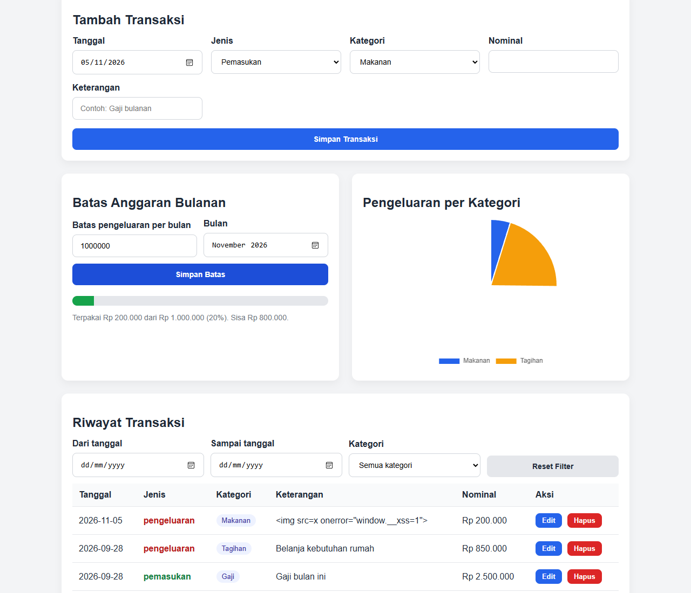

# Verifikasi dan Pengujian Akhir

Alur: **Fresh clone → Pull Request → Install → Run → Build → Deploy**

## 1. Status Saat Ini

| Tahap | Status | Keterangan |
|---|---|---|
| Fresh clone | ⚠️ Simulasi | Clone lokal dari commit `b26ab75`, ditambah perubahan yang belum di-commit |
| Pull Request | ⬜ Belum dilakukan | Perubahan belum di-commit atau di-push |
| Install | ✅ Terverifikasi | PHP 8.2.12, tanpa dependensi tambahan |
| Run | ✅ Terverifikasi | Backend dan frontend berjalan |
| Build | ✅ Terverifikasi | 7 file di `dist/keuangan-demo` |
| Deploy demo lokal | ✅ Terverifikasi | Smoke test 5/5, E2E 13/13 |
| Unit test | ✅ **ALL PASSED, 60/60** | [`build_dan_test.txt`](bukti/build_dan_test.txt) |

> **Yang masih harus dilakukan:** setelah PR dibuat, ulangi bagian 3 dari clone GitHub yang sebenarnya, lalu isi tabel di bagian 4. Baru setelah itu fresh clone bisa dinyatakan terverifikasi penuh.

## 2. Bukti Hasil Uji

Dijalankan 5 November 2026, dari folder hasil clone yang bersih.

### Unit & integration test

```console
$ php tests/run_tests.php
...
== Integrasi: API ==
[PASS] GET mengembalikan data, kategori, dan ringkasan
[PASS] POST menambah transaksi dengan id baru
...
[PASS] error 500 generik dengan kode referensi yang ada di log

ALL PASSED: 60/60 test lulus
```

| Kelompok | Jumlah | Hasil |
|---|---:|---|
| Perhitungan saldo | 5 | ✅ PASS |
| Validasi input | 27 | ✅ PASS |
| Log aman | 6 | ✅ PASS |
| Penyimpanan & penguncian | 5 | ✅ PASS |
| Integrasi API | 17 | ✅ PASS |
| **Total** | **60** | **✅ ALL PASSED** |

### Pemindaian keamanan

```console
$ php tests/security_scan.php
Ringkasan: 18 PASS, 0 FAIL, 1 OPEN (total 19)
```

`OPEN` adalah SEC-19, yaitu login yang belum ada. Lihat [Laporan Keamanan](LAPORAN_KEAMANAN.md#4-risiko-yang-masih-terbuka).

### Build

```console
$ php scripts/build.php
BUILD BERHASIL: 7 file di dist/keuangan-demo
```

### Smoke test demo

```console
$ php scripts/smoke_test.php
[PASS] GET http://localhost:8000/api.php -> HTTP 200
[PASS] GET http://localhost:8000/index.php -> HTTP 200
[PASS] GET http://localhost:8080/ -> HTTP 200
[PASS] GET http://localhost:8080/assets/app.js -> HTTP 200
[PASS] GET http://localhost:8080/assets/style.css -> HTTP 200
SMOKE TEST PASS
```

### E2E di browser (Microsoft Edge headless)

Hasil 13/13 PASS, mencakup: muat data, saldo, grafik, tambah, payload XSS sebagai teks, edit, filter, batas anggaran, hapus, data tetap ada setelah muat ulang, dan tanpa error konsol. Rincian: [`smoke_dan_e2e.txt`](bukti/smoke_dan_e2e.txt).

Skrip E2E memakai Puppeteer dan dijalankan di luar repo, jadi **tidak termasuk** dalam `php tests/run_tests.php`. Bagian 3 memakai pemeriksaan manual sebagai gantinya.



## 3. Checklist Verifikasi dari Awal

### A. Fresh clone

```bash
git clone -b php-keuangan https://github.com/Dazdimas/Rpl_dimaz.git keuangan-verifikasi
cd keuangan-verifikasi
```

- [ ] Clone berhasil, dan folder `backend/`, `frontend/`, `tests/`, `scripts/` ada
- [ ] `storage/data.json` belum ada (data tidak ikut ter-commit)

> Opsi `-b php-keuangan` wajib. Tanpa itu, Git mengambil branch `main` di GitHub yang berisi versi Flask.

### B. Pull Request

Lakukan di folder project. `main` lokal sama dengan `php-keuangan` di GitHub.

```bash
git checkout -b feat/pertemuan-8-keamanan
git add .gitignore CHANGELOG.md README.md backend frontend scripts storage/.htaccess tests docs
git commit -m "feat: pengerasan keamanan, log aman, test, dan dokumentasi Pertemuan 8"
git push -u origin feat/pertemuan-8-keamanan
```

Buat PR di GitHub dengan **base `php-keuangan`** dan **compare `feat/pertemuan-8-keamanan`**. Base `main` tidak bisa dipakai karena riwayatnya tidak terhubung dengan kode PHP.

- [ ] Diff PR hanya berisi perubahan yang dimaksud
- [ ] `storage/data.json`, `storage/logs/`, dan `dist/` tidak ikut
- [ ] PR sudah di-review, lalu di-merge

### C. Install

```bash
php -v
php -r "echo extension_loaded('mbstring') ? 'mbstring OK' : 'mbstring TIDAK ADA', PHP_EOL;"
```

- [ ] PHP 8.0 atau lebih baru (teruji pada 8.2.12)
- [ ] `mbstring OK`

### D. Run dan test

```bash
php tests/run_tests.php
php tests/security_scan.php
```

- [ ] Baris akhir test: `ALL PASSED: 60/60 test lulus`
- [ ] Baris akhir pemindaian: `18 PASS, 0 FAIL, 1 OPEN`

### E. Build

```bash
php scripts/build.php
```

- [ ] Muncul `BUILD BERHASIL: 7 file di dist/keuangan-demo`

### F. Deploy demo

Terminal 1:

```bash
php -S localhost:8000 -t dist/keuangan-demo/backend
```

Terminal 2:

```bash
php -S localhost:8080 -t dist/keuangan-demo/frontend
```

Terminal 3:

```bash
php scripts/smoke_test.php
```

- [ ] Muncul `SMOKE TEST PASS`

### G. Pemeriksaan manual di `http://localhost:8080`

- [ ] Dashboard tampil dengan 3 transaksi contoh dan saldo akhir Rp 7.150.000
- [ ] Tambah transaksi: tabel, saldo, dan grafik ikut berubah
- [ ] Keterangan `<b>uji</b>` tampil sebagai teks biasa
- [ ] Edit, hapus, filter, dan batas anggaran berfungsi
- [ ] Data tetap ada setelah halaman dimuat ulang dan server dijalankan ulang
- [ ] Konsol browser (F12) tanpa error
- [ ] `http://localhost:8000/data.json` membalas 404

## 4. Catatan Hasil Verifikasi Akhir

Isi setelah menjalankan bagian 3 dari clone GitHub.

| Tahap | Hasil | Tanggal | Penguji | Catatan |
|---|---|---|---|---|
| Fresh clone | | | | Commit: |
| Pull Request | | | | Link PR: |
| Install | | | | Versi PHP: |
| Unit test | | | | Hasil: /60 |
| Pemindaian keamanan | | | | Hasil: |
| Build | | | | |
| Deploy demo & smoke test | | | | |
| Pemeriksaan manual | | | | |
